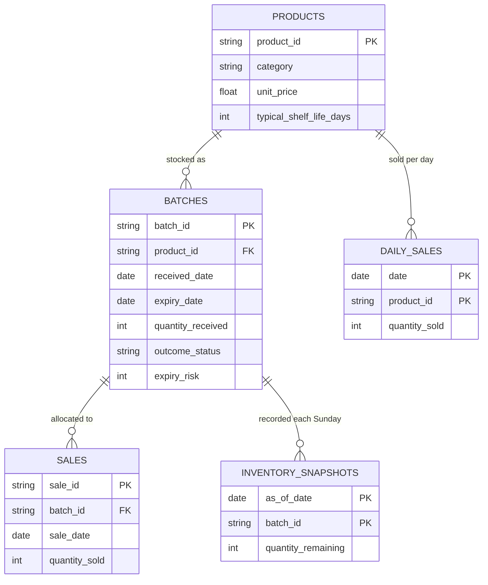
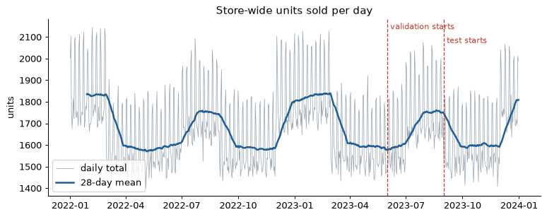
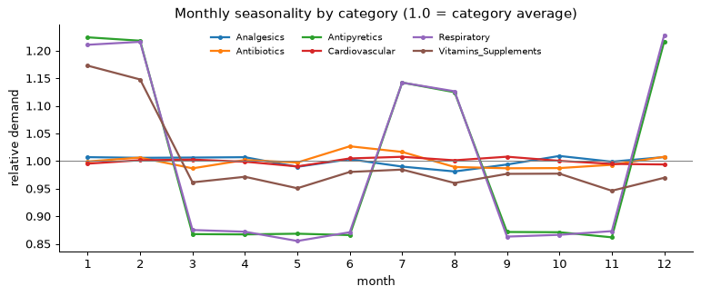
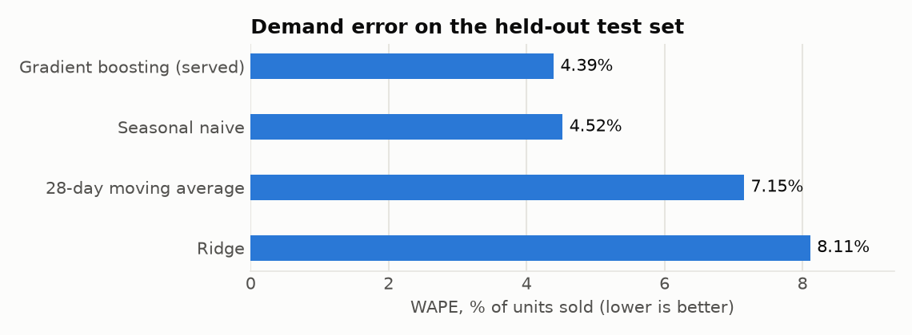
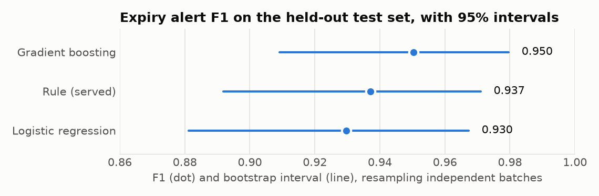
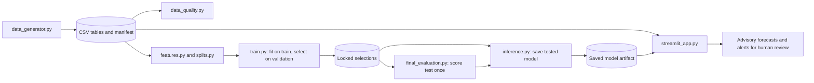

# Pharmacy medicine demand and expiry-risk forecasting: technical report

AI & Machine Learning individual project. All results come from synthetic data, and the
outputs are advisory stock guidance for human review, never medication or treatment
advice.

## 1. Summary

The project forecasts 30-day product demand and flags stock batches likely to expire with
material leftover stock, for a single simulated pharmacy.

| Task | Served approach | Held-out test result | Best comparison |
|---|---|---|---|
| Demand, 30-day units per product | Tuned gradient boosting | MAE 26.74, RMSE 36.01, WAPE 4.39% | Seasonal naive: MAE 27.51, RMSE 35.56, WAPE 4.52% |
| Expiry alert per batch | Transparent projected-leftover rule | Precision 0.93, recall 0.94, F1 0.94 (95% interval 0.89 to 0.97) | Gradient boosting: F1 0.95 (0.91 to 0.98) |

Three findings matter most:

1. **Simple baselines are hard to beat here.** Gradient boosting and seasonal naive are close
   on demand. The simulator repeats its seasonality exactly each year, which favours
   seasonal naive.
2. **No expiry model clearly beat the rule on validation**, so the transparent rule was kept.
   On test, gradient boosting had two fewer false alarms. A locked choice cannot be changed
   using test results, and the intervals overlap heavily.
3. **The rule's errors have specific, traceable causes.** These are explained in section 11.

## 2. Problem definition

| Item | Demand | Expiry risk |
|---|---|---|
| Business decision | Whether to review a reorder | Whether to prioritise stock rotation for a batch |
| Prediction unit | Product at a date | Batch at a date |
| Point of prediction | End of a Sunday | End of a Sunday, at the batch's first snapshot within 60 days of expiry |
| Target | Total recorded units sold over t+1 to t+30 | Batch expires with more than 20% of its received quantity unsold |
| Horizon | 30 days | Until the batch sells out or expires |

The 20% cutoff is a declared demonstration business rule, not a clinical threshold.

Unknown outcomes stay unknown. A batch still unexpired with stock at the end of the data is
**censored**, and is never treated as safe. Sold-out batches are known negatives because the
simulator has no returns.

## 3. Data

**Source and licence.** All data is generated by `src/data_generator.py` with seed 42. It has
no licensed third-party, personal or patient data. The default run has 80 products over 730
days, from 2022-01-01 to 2023-12-31. Data files are reproduced by command, and
`data/manifest.json` records their SHA-256 hashes.

| Table | Rows | Grain |
|---|---:|---|
| `products` | 80 | Product |
| `batches` | 2,003 | Batch |
| `sales` | 59,281 | Sale allocation to one batch |
| `daily_sales` | 58,400 | Product-day, including zero sales |
| `inventory_snapshots` | 39,062 | Active batch at a Sunday |

**Simulation assumptions.** Demand is Poisson, with category seasonality and a weekend lift.
Stock is sold first-expiry-first-out (FEFO). Restocking is immediate, so the default run has
no stockouts. Short-dated deliveries (30% chance) and tripled delivery sizes (15% chance) are
deliberate **stress scenarios**, not estimates of real pharmacy rates.

**Observed outcomes.** 389 positive, 1,063 negative and 551 unknown batches.

**Quality checks.** `src/data_quality.py` fails on broken keys, foreign keys, invalid dates or
quantities, stock imbalance, incomplete product-days, incorrect historical balances, missing
snapshots or invalid labels. The default data passes every check. Passing shows consistency,
not forecasting accuracy.

**Missing values and outliers.** The only missing cells are `outcome_date` and `expiry_risk`
for the 551 censored batches, and they are deliberately left missing. 16 of 58,400 product-days
exceed their product's mean plus four standard deviations. These are genuine Poisson variation,
so nothing is removed or capped.

## 4. Exploratory analysis

The full analysis is in the [executed notebook](../notebooks/01_eda.ipynb). Relationships
between features and targets were examined on training data only.

- Respiratory and antipyretic products peak in winter (December to February) and in the
  monsoon (July and August). Vitamins peak in January and February.
- Weekends run about 20% above weekdays. This mostly averages out over a 30-day window.
- Recent sales nearly determine the 30-day total: Spearman correlation is 0.99 on training data.
- There are 31 zero-sales product-days and no stockouts. Real sales would be censored by
  stockouts, which this data cannot show.
- Many risky batches are short-dated deliveries first seen fewer than 30 days before expiry.
  This separation partly reflects the stress scenario.

## 5. Features

Each feature uses only data recorded through the end of the prediction date.

| Task | Group | Features |
|---|---|---|
| Demand | Recent sales | `sales_7d`, `sales_14d`, `sales_28d`, `sales_56d`, `mean_28d`, `std_28d`, `zero_days_28d` |
| Demand | Seasonal | `sales_same_window_last_year`, `month`, `week_of_year` |
| Demand | Stock | `on_hand_units`, from the dated snapshot |
| Expiry | Batch at snapshot | `days_to_expiry`, `days_since_received`, `quantity_received`, `quantity_remaining`, `fraction_remaining` |
| Expiry | Queue and demand | `units_ahead_fefo`, `product_on_hand`, `sales_7d`, `mean_28d`, `projected_leftover_fraction` |
| Both | Product | `category`, `unit_price`, `typical_shelf_life_days` |

`projected_leftover_fraction` is the share of received units projected to remain unsold, after
projecting sales as the 28-day rate times days left, minus units ahead in the FEFO queue.

Preprocessing is fitted on training rows only and differs by model. Linear models use median
imputation with missing indicators, scaling and one-hot encoding, including one-hot `month`.
Boosted trees use one-hot `category` and handle missing values directly. Same-window-last-year
sales are missing for 71% of training rows because the first year has no prior year.

## 6. Leakage analysis

| Risk | Treatment |
|---|---|
| Simulator-only `base_daily_demand`, `simulated_demand`, `unmet_demand` | Never features; enforced by a test |
| Final batch balance (`batches.quantity_remaining`) | Never a feature; snapshot stock is used |
| `outcome_status`, `outcome_date`, `expiry_risk` | Labels only |
| Sales after the prediction date | Rolling windows end at the prediction date |
| Target window crossing a boundary | Origin excluded |
| Outcome resolving after a boundary | Batch excluded |
| Repeated snapshots of one batch | One snapshot per batch, so counts are independent |

**Evidence.** The generator is prefix-stable, so a shorter run is the longer run with the future
removed. Features computed on both match for every date in the shorter run. Injecting a future
sales shift, or the final batch balance, made those tests fail. Changing validation or test
labels leaves fitted models unchanged.

## 7. Split strategy

Splits are chronological, with the same calendar dates for every product.

| Period | Prediction dates | Demand rows | Expiry batches (positive / negative) |
|---|---|---:|---:|
| Train | Through 2023-04-30 for demand | 4,960 | 236 / 157 |
| Validation | From 2023-06-01 | 720 | 25 / 29 |
| Test | From 2023-09-01 | 1,040 | 71 / 32 |
| Excluded | Targets or outcomes crossing a boundary, or warm-up | 640 | 136 |

The 136 excluded expiry batches are 32 with unknown outcomes, 56 resolving after a boundary,
and 48 inside the 28-day feature warm-up.

## 8. Models and metrics

| Task | Baselines | Candidates |
|---|---|---|
| Demand | 28-day moving average × 30; seasonal naive (same 30 days last year) | Ridge; gradient boosting |
| Expiry | Projected leftover above 20% | Logistic regression; gradient boosting |

Boosting's early stopping is off, because it would draw a random, non-chronological holdout.

**Demand metrics.** MAE and RMSE are in units. WAPE is total absolute error as a share of units
sold, which gives more weight to high-volume products. It is undefined when no units sold.

**Expiry metrics.** Precision, recall, F1 and the confusion matrix. A missed batch means possible
write-off, and a false alarm means an unnecessary stock review. Precision and recall are both
reported because no real cost data exists to weigh them. Scores with a zero denominator are
reported as undefined, not zero. Intervals come from a 1,000-resample bootstrap over independent
batches.

## 9. Validation and selection

**Demand, 720 validation rows.** Nine gradient-boosting settings were compared on validation MAE.

| Model | MAE | RMSE | WAPE |
|---|---:|---:|---:|
| Gradient boosting, tuned (400 iterations, 31 leaves) | 28.71 | 40.88 | 4.47% |
| Seasonal naive | 28.92 | 38.62 | 4.51% |
| Gradient boosting, default | 30.61 | 44.07 | 4.77% |
| 28-day moving average | 49.56 | 81.74 | 7.72% |
| Ridge | 55.15 | 80.93 | 8.59% |

**Expiry, 54 validation batches.** The selection rule was fixed before the test set was opened:
keep the rule unless a candidate's 95% paired bootstrap interval for its F1 minus the rule's F1
is entirely above zero.

| Model | Cutoff | F1 | F1 minus rule (95% interval) |
|---|---:|---:|---|
| Rule | n/a | 0.941 | n/a |
| Gradient boosting | 0.55 | 0.941 | 0.000 to 0.000 |
| Logistic regression | 0.55 | 0.939 | -0.062 to 0.055 |

Neither candidate cleared the bar. These selected scores are optimistic, because the same rows
chose the settings.

**Served demand model.** Gradient boosting was chosen as a trained, servable model. Its validation
results were close to seasonal naive, and seasonal naive benefits from the simulator's exact
yearly repeat.

## 10. Held-out test results

Selections were locked on validation and the evaluation code was committed before scoring. The
test set was scored once, and nothing was changed because of the results.

| Demand, 1,040 rows | MAE | RMSE | WAPE |
|---|---:|---:|---:|
| **Tuned gradient boosting (served)** | **26.74** | 36.01 | **4.39%** |
| Seasonal naive | 27.51 | **35.56** | 4.52% |
| 28-day moving average | 43.55 | 78.61 | 7.15% |
| Ridge | 49.38 | 74.64 | 8.11% |

| Expiry, 103 batches | TP | FP | FN | TN | Precision | Recall | F1 (95% interval) |
|---|---:|---:|---:|---:|---:|---:|---|
| **Rule (served)** | 67 | 5 | 4 | 27 | 0.93 | 0.94 | **0.94** (0.89 to 0.97) |
| Gradient boosting (cutoff 0.55) | 67 | 3 | 4 | 29 | 0.96 | 0.94 | 0.95 (0.91 to 0.98) |
| Logistic regression (cutoff 0.55) | 66 | 5 | 5 | 27 | 0.93 | 0.93 | 0.93 (0.88 to 0.97) |

The F1 axis starts at 0.86 so that the intervals can be read.

**Business reading.** The served demand model's typical error is about 4% of units sold. The rule
caught 67 of 71 risky batches, and 67 of its 72 alerts were correct. These figures describe
a synthetic stress test and do not show real-pharmacy performance.

## 11. Error analysis and explanation

**Demand bias and spread.** Mean actual minus predicted is 0.38 units, so there is no meaningful
overall bias. WAPE ranges from 3.87% to 4.79% across test dates, and from 3.65% (analgesics) to
5.71% (antibiotics) across categories. The served model beats seasonal naive's WAPE in four of
six categories; seasonal naive is better for antipyretics and respiratory, the two strongly
seasonal categories.

**Most influential inputs.** Permutation importance, as the rise in MAE when one input is shuffled:

| Input | MAE increase |
|---|---:|
| `sales_14d` | 82.3 |
| `sales_56d` | 70.0 |
| `sales_28d` | 63.6 |
| `sales_7d` | 54.3 |
| `sales_same_window_last_year` | 29.8 |

Rolling sales inputs are strongly correlated, so shuffling one understates the group. These
results show what the model relies on, not what causes demand.

**One prediction and error.** The largest error was MED-051 (antipyretics) at origin 2023-11-19.
It sold 1,610 units over the next 30 days. The model predicted 1,425, about 12% too low, while
seasonal naive predicted 1,593. Resetting one input at a time to its typical training value
shows what raised the forecast: 14-day sales of 561 (+267 units), 7-day sales of 275 (+255),
56-day sales of 2,309 (+146) and the late-November week (+116). `unit_price` also shows +91, but
price does not drive demand in the simulator, so that effect is association.

The target window runs from November 20 to December 19, and antipyretic demand steps up 40% in
December. The model has seen only one earlier November-to-December transition, so it
under-forecast the step.

**Rule errors.** All nine were traced through the sales records.

| Cause | Count | Example |
|---|---:|---|
| False alarm: stock counted as ahead in the queue expired before demand reached it | 5 | BAT-01765 had 1,196 units ahead. Only 138 sold before expiring, and this batch then sold all 833 units |
| Missed: a later delivery with an earlier expiry took the demand | 2 | BAT-01803 sold 297 units after a later delivery took 1,021, and it expired 54% unsold |
| Missed: demand fell | 1 | BAT-01712 used 45.5 units per day that included the monsoon peak; actual was 34.6 |
| Missed: close to the line | 1 | BAT-01762 was projected at 14.8% and ended at 21.1% |

A possible improvement is to count only queued units that can sell before their own expiry. It
was not applied, because the idea came from test errors and would need new data to evaluate.

## 12. Inference interface

The Streamlit app loads the saved model from disk, and its forecasts come from that loaded model.
A test replaces the model with one that always returns 100, and every forecast becomes 100. The
user picks a Sunday review date. The app then shows:

- each product's 30-day forecast, compared with stock on hand;
- a typical error range based on test WAPE;
- the inputs that moved one forecast the most;
- near-expiry batches with the rule's suggested action;
- the model's limitations.

A batch without enough sales history is shown as unknown rather than safe. Forecasts and alerts
are unchanged when data after the review date is removed. The demo is local only.

## 13. Reproducibility

Commands are in the [README](../README.md). They regenerate the data, features, EDA notebook,
validation report, test evaluation and saved model. The project uses Python 3.13, seed 42 and
fully pinned dependencies in `requirements.txt`.

CI on Windows and Linux installs the pinned stack, runs all tests and the whole pipeline, and
checks that data hashes, the quality report and the split report match the checked-in versions.
Model reports are not compared byte for byte, because boosted-model floats can differ slightly
between operating systems. The model file is not stored in Git and is rebuilt by
`python -m src.inference`.

## 14. Responsible use

**Representativeness.** The data is synthetic, for one store. Alert rates reflect deliberate stress
scenarios. There are no real stockouts, lead times, returns, promotions or multi-store effects. The
test period covers one autumn, with targets ending in December, so other seasons are untested.

**Bias.** No people are represented, so demographic bias cannot be measured here. A real deployment
could under-serve products or communities if stockouts hide demand, since recorded sales would
understate need. Low-volume products would also deserve separate error checks.

**Privacy.** The project uses no patient, personal or confidential data. Real pharmacy data would
need access controls and a privacy review, and patient-level data is not required for this task.

**Failure modes.**
- Demand shifts that recent sales have not yet shown, as in the December example.
- Queued stock expiring before it can be sold, which causes false alarms.
- Later short-dated deliveries, which the rule cannot foresee.
- Seasonal patterns that differ from the simulator's repeating calendar.
- Stock on hand includes units that may expire within the 30-day window, so reorder flags can be
  optimistic.

**Human oversight.** Every output is a suggestion for a pharmacist or inventory manager. Nothing is
ordered or moved automatically, and the app never gives medication or treatment advice.

## 15. Status and known gaps

| Acceptance test | Status | Evidence |
|---|---|---|
| Reproduce the split and training from README commands | Done | README; CI on Windows and Linux |
| Baseline and candidate metrics on an untouched test set | Done | Section 10 |
| Real prediction through the app from the saved model | Done | Section 12 |
| Explain a prediction, error, influential inputs and a limitation | Done | Section 11 |
| Show no prohibited leakage or sensitive data | Done | Sections 3 and 6 |

**Not included.** There is no hosted live demo, so the app is local only, and no API, which the
project scope treats as optional. The tuned settings were chosen from a deliberately small search,
and the best one sits at the edge of that grid.

## 16. Sources

Synthetic data from this repository's generator. Libraries: NumPy, pandas, scikit-learn, joblib,
matplotlib, Streamlit, pytest, and Jupyter tooling, at the versions pinned in `requirements.txt`.
